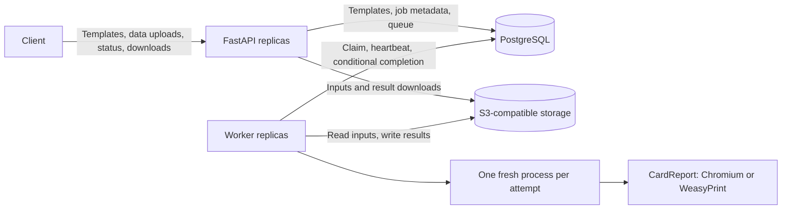
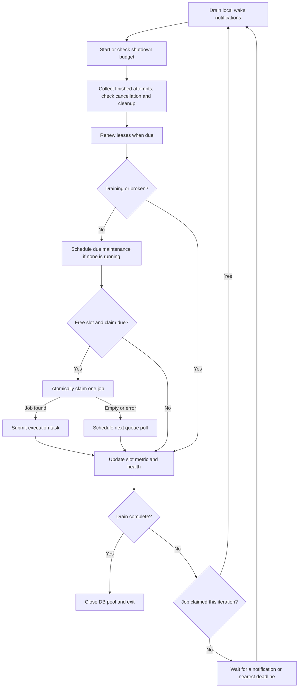

# Architecture and worker lifecycle

This document describes the current implemented service, including worker checks
and failure paths. The [design](design.md) and
[implementation plan](implementation-plan.md) preserve the original decisions
and delivery history. See [operations](user/operations.md)
for configuration defaults, deployment commands and error-code reference.

## Components and ownership

CardReport Server accepts stored template references and named datasets, runs
reports asynchronously, and serves their results. Template management is separate
from report submission: clients register an immutable JSON/YAML template version,
then submit data against that version or resolve the latest version at admission.



| Component | Responsibility and durable state |
| --- | --- |
| FastAPI | Template management, bounded streaming admission, status and downloads; no durable local state |
| PostgreSQL | Immutable template versions, job state, ownership tokens, leases, retry schedule and artifact metadata |
| S3-compatible storage | Uploaded dataset bundles and generated PDF/HTML objects |
| Worker supervisor | Bounded execution slots, DB/S3 access, child lifetime, ownership renewal and maintenance |
| Attempt child | Parse datasets, bind the template and call CardReport; no DB/S3 credentials |
| CardReport | Authoritative schemas, semantic validation, layout, rendering and owned renderer-process cleanup |

PostgreSQL is the durable queue. The service does not need a separate message
broker. Workers can be replaced because inputs and job ownership live outside
containers. Temporary files are local and disposable; each worker must have its
own exclusive temporary root and process namespace.

The API and workers share an image but scale independently. A worker runs up to
`WORKER_CONCURRENCY` attempts, not just one report. With identical settings, the
nominal capacity is replicas multiplied by slots; CPU, memory, database and
storage capacity still constrain useful parallelism.

The API has no built-in authentication. Deployment assumes a trusted internal
network. Container isolation and credential separation do not turn it into a
sandbox for arbitrary code or hostile multi-tenant workloads.

## High availability

API replicas can run active-active behind the internal load balancer or Kubernetes
Service. They share PostgreSQL and S3; clients need no sticky sessions. Worker
replicas also run active-active against the same queue. Atomic claims, leases and
attempt tokens coordinate them without an elected application leader. Every healthy, non-draining
worker runs maintenance, so recovery does not depend on the failed worker returning.

| Failure | Effect and recovery |
| --- | --- |
| API process or pod disappears | Other ready replicas can serve new requests. An in-flight upload or download may fail; it is not resumed by another replica. Already accepted jobs remain in PostgreSQL/S3. |
| Worker process or pod disappears | Other workers continue their jobs. Maintenance recovers its expired leases; eligible jobs are retried, while expired deadlines or exhausted attempts become terminal failures. |
| Node disappears | The same rules apply to all replicas on that node. Continued service requires replicas and spare capacity on surviving nodes. |
| PostgreSQL is unavailable | Admission, status, claims and result commits cannot proceed. Existing renders cannot safely complete ownership checks; workers cancel against their last confirmed lease horizon when the supervisor can progress. |
| S3 is unavailable | Admission and result downloads are unavailable; input reads and result uploads may retry or fail under the normal attempt policy. Rendered bytes alone do not make a successful job; failed readiness also removes API replicas from the Service. |

There is no fixed failover time: recovery depends on lease expiry, maintenance
scheduling, retry backoff, polling, free capacity and dependency availability.
A job is recoverable after worker loss, but not guaranteed to succeed: deadlines
and attempt limits still apply. A partitioned worker cannot commit after its lease
expires or its token is replaced. Computation can run more than once.

API readiness checks both the expected database schema and S3 bucket access.
A shared dependency outage can therefore remove every API replica from service.
Worker health measures supervisor progress; its readiness probe is not a separate
queue admission gate. See [health and observability](#health-observability-and-code-map).
Adding application replicas does not remove a shared database or storage failure.

### Deployment requirements and current limits

The bundled [application manifests](../deploy/kubernetes/app.yaml) start with one
API replica and one worker replica; the worker HPA also permits a minimum of one.
They contain no PodDisruptionBudget or explicit pod spreading rules. Compose and
the single-node kind acceptance environment are development/test deployments,
not HA configurations. Existing pod-recovery and HPA tests do not establish
multi-node or multi-zone availability.

For an HA deployment, operators need to configure:

- At least two API and worker replicas, with worker HPA minimum replicas preserving
  the desired baseline. Place replicas across the failure domains to survive,
  using [topology spread constraints](https://kubernetes.io/docs/concepts/scheduling-eviction/topology-spread-constraints/)
  or pod anti-affinity, and reserve capacity on surviving nodes.
- A redundant internal ingress/load balancer and available cluster control plane,
  DNS and network paths to dependencies.
- PostgreSQL with a consistent writable endpoint and an operator-managed failover
  policy, plus durable, highly available S3-compatible storage. Replication,
  backups, restore tests and acceptable data-loss/recovery windows belong to those
  services; application leases cannot recover data lost by them.
- Suitable [PodDisruptionBudgets](https://kubernetes.io/docs/concepts/workloads/pods/disruptions/)
  for eviction-based voluntary disruptions. These do not prevent node failures
  or replace the replica count, placement and graceful shutdown settings.
- Tested dependency failover and node-loss scenarios under representative load.
  Backups provide recovery, not uninterrupted availability.

Ordinary replica replacement uses the shutdown/recovery mechanisms below.
Schema or engine upgrades use the coordinated
[drain and upgrade procedure](user/operations.md#upgrade-and-rollback); the service
does not promise zero-downtime migrations or compatibility between arbitrary images.

## Scaling

API capacity and rendering capacity are independent. Settings below omit the
`CARDREPORT_` prefix; their defaults and ranges live in
[operations](user/operations.md#configuration-and-budgets).

| Control | What grows | Main constraints |
| --- | --- | --- |
| API replicas | Concurrent template/status/download requests and upload capacity | DB connections, S3 throughput, network and per-replica `UPLOAD_SLOTS` |
| Worker replicas | Independent supervisors and execution slots | Cluster capacity, DB/S3 load and renderer startup time |
| `WORKER_CONCURRENCY` per worker | Attempts running inside one container | CPU, peak memory, temporary disk, shared DB pool and cleanup headroom |

For identical workers, nominal parallel attempts = worker replicas ×
`WORKER_CONCURRENCY`; for differing settings, sum their slot counts. A slot includes
input download, rendering, upload and completion cleanup. Each attempt can create
several renderer/browser processes, so this is not an OS-process count or a
promise of proportional throughput. Increasing slots also increases the number
of jobs interrupted if that container is recycled.

### Implemented autoscaling

The worker HPA in the application manifests uses CPU utilization relative to CPU
requests, with a configured minimum, maximum and scale-down stabilization window.
It requires Metrics Server and valid CPU requests. See the
[Kubernetes HPA behavior](https://kubernetes.io/docs/concepts/workloads/autoscaling/horizontal-pod-autoscale/).
There is no API HPA, queue-driven autoscaler or scale-to-zero mechanism bundled
with the service. CPU-based scaling may react poorly to an I/O-bound backlog;
queue age and available slots must also be monitored.

A new worker must pass schema/storage checks and both renderer smokes before it
claims jobs. Once started, it fills free slots immediately between supervisor
checks. More replicas do not eliminate startup latency or empty-queue polling.

Scale-down sends the normal termination signal: the worker stops claiming, drains
active attempts and continues heartbeats during its shutdown budget. Attempts
that cannot finish are cancelled or lost on container termination and recovered
through the lease policy. Running reports do not migrate between processes, and
an interrupted attempt still counts towards `MAX_ATTEMPTS`. Configure container
termination grace above `SHUTDOWN_GRACE` and leave adequate surviving capacity.
An HPA stabilization window reduces replica churn; it does not guarantee every
report finishes before a scale-down.

### Capacity planning and shared limits

`UPLOAD_SLOTS` is per API process, so adding API replicas increases total upload
concurrency. The backlog limit is a soft global admission check, not a strict
cross-replica semaphore: concurrent admissions can overshoot it. Per-request
input, output and dataset limits remain unchanged by replica count.

Each API/worker process has its own pool capped by `DB_POOL_SIZE`. Budget database
connections across all replicas, migrations and operational clients. Each worker
may also open one short-lived dedicated connection while attempting cleanup; it
is outside that pool so a one-slot pool remains usable. More workers
also add heartbeat and maintenance traffic; more uploads and completions increase
S3 and network load. HPA cannot fix a saturated shared database or object store.

The API's `cardreport_jobs` and `cardreport_queue_oldest_seconds` gauges describe
the same global queue on every replica: aggregate duplicate scrapes with `max`,
not `sum`. Queue age starts at original admission and includes retry backoff;
it is not just time waiting for a free slot. Sum per-worker active-slot gauges
for occupied execution capacity.
Observe queue age, completion latency, failures, CPU, peak memory and temporary-disk
usage during representative load tests before choosing slots, requests, limits
and maximum replicas. Input file size alone does not predict rendering memory;
datasets, fonts and browser descendants contribute to the peak.

Deployment commands and acceptance limits are in the
[Kubernetes guide](user/kubernetes.md). The supplied resource values are starting
points, not a measured production capacity guarantee.

## Web console and history

The API also serves the console at `/ui/`, with native JavaScript modules and CSS
packaged in the same image. It calls the public API; no frontend service or durable
browser state is involved. Swagger and console assets have separate mounts and
headers. Template editing creates new immutable versions.

`GET /v1/reports` exposes retained public job metadata with template/state filters
and keyset pagination by `(created_at, id)` descending. Cursors carry position,
not database snapshots or access permissions; deleted boundary rows do not break
continuation. Existing status and list responses share an explicit field projection.
History has two indexes applied through an explicit schema migration.

HTML content can be streamed inline using the same expiry and download checks.
The console uses a sandboxed iframe; the response CSP allows embedded chart scripts
while blocking parent-origin access and resource fetches. Self-navigation remains
possible, so this is not a sandbox for arbitrary hostile HTML. Inputs remain
validated templates/data rendered by CardReport. The console scales the iframe
to the pinned template’s page width, keeping stored content unchanged. PDF can
open in a separate tab using the browser’s native viewer; it is not embedded in
the console and has a separate inline response policy.
See the [console guide](user/web-console.md) and [API](user/api.md) for usage.

## Before a worker sees a job

1. The API validates request metadata: admission state, media type, size headers,
   template reference, output kind and selected renderer. It acquires a bounded
   upload slot and checks the soft backlog limit.
2. Admission pins a template version. A later change to the latest version does
   not change the admitted job.
3. The API streams the body to a private temporary file, counts bytes and computes
   SHA-256. It enforces total upload time, idle read time and actual input size,
   including requests without a declared content length.
4. It writes the complete input to a unique S3 key, then inserts the queued job in
   PostgreSQL, rechecking backlog capacity and the DB-side admission deadline.
   The row retains input size/hash,
   template version, renderer, output kind and retention settings.
5. Only after both steps succeed does it return HTTP 202 with status/content URLs.

HTTP 202 means durable acceptance. Dataset parsing, types, cardinality and binding
are checked later by the attempt child. Streaming admission bounds upload memory;
it does not make parsing or rendering stream-based. The child materializes the
bounded dataset bundle.

S3 and PostgreSQL do not share a transaction. A successful input upload followed
by a failed DB insert can leave an orphan object. A lost or error HTTP response
does not prove that the job was not created: a commit acknowledgement can be lost
after acceptance. Submission has no idempotency protocol; a client retry may
create a second report.

## Processes, threads and slots

A worker container contains one supervisor process. Its main thread runs the
scheduling loop. A `ThreadPoolExecutor` has `WORKER_CONCURRENCY + 1` threads:
one blocking execution task per active attempt, plus capacity for maintenance.

An execution thread downloads inputs, starts a fresh attempt process, waits for
it, uploads the result and completes the database update. Threads let these waits
and blocking SDK calls proceed without running the scheduler inside the render
call. They do not perform report generation in a shared Python process.

The attempt child calls CardReport, which may start its own renderer worker and
browser descendants. The whole container is the final process-cleanup boundary:
some descendants are in detached process groups.

Only the supervisor loop adds/removes entries in its active-attempt map. An entry
holds its token, local deadline, last confirmed lease horizon, cancellation flag,
child handle, termination time and execution future. A slot becomes free when the
execution future finishes, including upload/DB work and final cleanup, not merely
when the renderer exits.

## Startup checks

The worker claims nothing until startup succeeds:

1. Load and validate `Settings`. Reject invalid connection formats, non-finite
   timers, out-of-range limits and inconsistent budgets. Relationships include
   lease greater than three heartbeat intervals, sufficient attempt/cleanup/I/O
   headroom, retry delay no greater than its cap, and retention lasting long enough
   for artifacts and downloads. The complete rules live in
   [settings.py](../src/cardreport_server/settings.py).
2. Remove the old health file and require the supported container environment.
   Disable process dumping with Linux `prctl` to protect supervisor credentials;
   failure prevents startup.
3. Create the dedicated temporary root. Remove only its non-symlink directories
   named `attempt-<valid UUID>`, which may survive a container restart.
4. Open the database pool and require the exact expected migration revision
   declared by the running service. Startup never runs migrations.
5. Check S3 bucket access with `HeadBucket`. This is a connectivity/access check,
   not proof that every future read or write will succeed.
6. Start a credential-free smoke process. It generates a small PDF with both
   Chromium and WeasyPrint, each under `STARTUP_RENDER_TIMEOUT`; the parent also
   enforces the combined `STARTUP_TIMEOUT`.
7. After successful smokes, install stop handlers, start metrics and enter the loop.

A failed smoke exits with status 78; a smoke that exceeds its parent deadline
triggers container recycling. Configuration, DB or storage startup errors also
prevent claiming work. The exact schema check is a startup gate, not a continuous
migration monitor; upgrades still require the coordinated procedure in operations.

## Supervisor loop and wakeups



The loop drains notifications, sets/checks the shutdown deadline, then visits
active attempts: it collects each
finished future or checks that attempt's cancellation and child-cleanup deadlines.
It next renews leases, schedules maintenance/claims, writes health and decides
whether to exit, continue immediately or wait.

After updating health and checking drain completion, a successful claim restarts
the outer loop immediately. Consequently, all free
slots can fill without a polling pause, while heartbeat, deadline and shutdown
checks still run between claims. The worker never claims an unbounded batch.

`SimpleQueue` contains local wake notifications only; it is not the job queue.
Attempt completion, maintenance completion, stop signals, renderer failure and
late cancellation during child launch can wake the supervisor. Notifications are
drained before inspecting state, so a completion just before waiting is not lost.

After an empty/error claim, the next claim normally waits for `POLL_SECONDS`.
Completion frees a slot and permits an earlier probe. There is no database push
notification: a new submission to an idle worker may wait until its next poll.

The wait ends at the earliest relevant event: queue poll, heartbeat, schedulable
maintenance, attempt/lease cancellation threshold, armed child-cleanup deadline
or global shutdown deadline. An already-running maintenance task and an already
cancelled attempt do not repeatedly schedule their expired deadlines and spin.
Local notifications cannot interrupt a synchronous database call. Statement and
lock timeouts are enforced by PostgreSQL; pool acquisition uses `IO_TIMEOUT`.
There is no client-side query read deadline: a lost connection can block until
the OS detects it or health probes trigger container termination.

## Atomic claim and temporary ownership

`jobs.claim()` selects one due `queued` row ordered by creation time and ID,
using `FOR UPDATE SKIP LOCKED`. In the same transaction it:

- changes the state to `running`;
- increments `attempt_no` and assigns a fresh UUID `attempt_token`;
- sets `lease_until` and `attempt_deadline` using database time;
- preserves the original first-start timestamp on subsequent attempts.

Competing workers skip locked candidates. Ordering prefers older eligible jobs;
it is not strict global FIFO under concurrent claims and retries.

The token identifies the current attempt. The lease is temporary permission to
work on the job; the attempt deadline is the maximum execution window. Heartbeats
can extend the lease only up to that attempt deadline.

The claim predicate checks state and retry eligibility time. Maximum queue age is
enforced separately by maintenance, not atomically in the claim query. Therefore
queue-age expiry is periodic, not a precise admission-to-execution deadline.

The supervisor uses a monotonic clock for local timers, anchored before the claim
call so DB latency consumes local budget. PostgreSQL independently enforces its
own timestamps. No comparison between host wall time and database wall time is
needed for ownership checks.

## Attempt preparation and rendering

The execution thread creates a private `attempt-<token>` directory with mode 0700,
loads the pinned template from PostgreSQL and downloads the stored dataset bundle.
It counts downloaded bytes against the input cap, then compares actual size and
SHA-256 with the job metadata. A size/hash mismatch is `input_integrity`; an
object exceeding the download cap currently becomes terminal `internal_error`.

Before launching the child, it checks cancellation and the remaining budget. It
writes the canonical template, raw input and explicit execution options into the
attempt directory. Only the allowlisted runtime environment reaches the child;
DB/S3 credentials and arbitrary inherited environment variables do not. `HOME`
and `TMPDIR` point to the attempt directory.

The child performs the following checks and actions:

1. Read the options and revalidate the stored template through CardReport.
2. Parse JSON/YAML datasets, or multipart JSON/YAML/CSV files, with
   the configured `DataLimits`, then bind them to the
   template using the library's public API.
3. Serialize the bound input datasets to a lossless, size-limited snapshot, then calculate remaining render time. A nonpositive remainder is a timeout, not a
   dataset error.
4. Instantiate the requested Chromium or WeasyPrint renderer and call
   `Report.to_pdf()` or `Report.to_html()`. There is no automatic engine fallback.
5. Check output size and write the result locally.
6. Write a bounded, sanitized outcome record to `outcome.tmp`, then atomically
   replace `outcome.json`. Exception text and dataset values are not copied into
   the public error response.

CardReport owns semantic, layout, font and export checks; the server does not
reimplement them. PDF is the checked output. Chromium HTML does not run browser
geometry checks at export; WeasyPrint HTML is measured but can differ in another
browser. WeasyPrint supports dashboard layouts, not automatic flow pagination.

## Time budgets

Names below omit the `CARDREPORT_` environment prefix. Defaults and valid ranges
have one reference: [configuration and budgets](user/operations.md#configuration-and-budgets).

```text
render_deadline = local_attempt_deadline - CLEANUP_GRACE - io_reserve
io_reserve     = 4 * IO_TIMEOUT
pdf_timeout    = min(RENDER_TIMEOUT, render_deadline - monotonic_now)

cancel_at      = min(local_attempt_deadline, confirmed_lease_until) - CLEANUP_GRACE
```

The render budget is evaluated after input preparation and binding. The default
whole-attempt budget is 120 seconds, so the default 300-second PDF cap normally
does not become the limiting value. CardReport accepts finite positive PDF
timeouts without a five-minute ceiling; the server's configurable cap and
whole-attempt validation bounds remain its own policy.

The I/O reserve is headroom for two S3 SDK connect/read attempts. It is not a total
I/O deadline or a guarantee of enough time for the final DB commit. S3 socket timeouts, DB connection establishment,
pool acquisition and server-side statement/lock limits have distinct roles; none
is a total end-to-end DB/S3 deadline.

HTML has no timeout argument in CardReport's public export API. WeasyPrint HTML
keeps its internal 30-second deadline; the supervisor still bounds the attempt
process for either HTML renderer. Cancelling an attempt does not forcibly
interrupt an execution thread blocked inside a DB/S3 call. That call must return or the
container must be terminated; server-side DB timeouts alone cannot bound a lost
network connection. Global shutdown has a container-level fallback.

Settings are read at process startup. Compose forwards tuning values from `.env`
or the shell; changed container environment requires recreation. See
[applying configuration](user/operations.md#applying-configuration), including
container termination grace and the native-versus-container connection settings.

## Accepting a successful result

The execution thread requires a clean child exit and a complete outcome record. If the
attempt was cancelled, it discards the outcome rather than accepting a result.
For a successful outcome it checks file size again and uploads to an
attempt-specific key: `results/<report-id>/<attempt-token>.<format>` under the
installation prefix.

Only then does `jobs.finish()` attempt the database completion update. All of
these conditions must still hold:

| Check | Why it matters |
| --- | --- |
| Matching report ID | Updates the intended job |
| Matching attempt token | Prevents an older attempt from overwriting its replacement |
| State is still `running` | Prevents a second completion of a terminal/requeued job |
| Lease has not expired | Rejects a worker that no longer owns the job |
| Attempt deadline has not expired | Rejects completion outside the execution budget |

The successful update records the S3 key, size, hash, engine/service/image versions
and expiry timestamps. Failed conditions update no row. A valid PDF or an uploaded
object alone is not a completed report: PostgreSQL must accept the result pointer.

If ownership is lost after upload, the unused object becomes an orphan. Storage
writes are not rolled back with database updates. Attempt-specific keys prevent
an old attempt from overwriting the winning result object.

## Heartbeats and ownership loss

At each heartbeat interval the supervisor sends active tokens to PostgreSQL.
The DB renews only running attempts whose lease and attempt deadline are still
valid, and returns the tokens it renewed.

A token missing from a successful heartbeat response causes cancellation. A DB
exception does not confirm either ownership or ownership loss: the supervisor
retains its last confirmed lease horizon and cancels before that horizon expires.
A successful renewal updates the local horizon from the heartbeat call's start
time, capped by the local attempt deadline.

Cancellation is checked again immediately after assigning a newly launched child
handle. This closes the race where the supervisor cancels while `Popen` is still
starting a process. The execution thread then requests termination and wakes the
supervisor so the child-cleanup clock is observed promptly.

## Failures, retries and job states

| Event | Action |
| --- | --- |
| Invalid datasets, binding or stored-template revalidation | Terminal `invalid_data` |
| Layout overflow, unsupported feature, render timeout or oversized output | Terminal error; no repeat of the same render |
| Export-stage validation or unexpected renderer error | Terminal `render_failed` |
| Input size/hash differs from recorded metadata | Terminal `input_integrity` |
| Retry-class DB/S3 or OS error during execution | `dependency_unavailable`; conditional retry while the attempt still owns a live lease |
| Runtime renderer dependency unavailable | Mark worker broken, stop new claims, conditionally retry this job and drain |
| Expired lease | Maintenance requeues or fails the job according to attempt count/deadline |
| Child crash or missing outcome record | Recycle the container; detached descendants may still exist |
| Child ignores termination, or shutdown budget expires | Recycle the container |

Unexpected supervisor-side errors that are not in the retry classes become
`internal_error` when completion can still be recorded. If recording a failure or
retry also fails, lease expiry allows a healthy worker's maintenance to recover it.

Normal retries and expired-lease recovery use the same delay calculation:

```text
retry_delay = min(RETRY_DELAY * 2 ** (attempt_no - 1), RETRY_MAX_DELAY)
```

`MAX_ATTEMPTS` counts the first attempt. The default of three permits at most two
retries. Reaching the attempt cap or an expired attempt deadline makes recovery
terminal; an expired deadline is reported as `render_timeout`. Lease recovery
otherwise records `worker_lost`, including terminal failure at the attempt cap.
Worker-triggered infrastructure retries instead retain `dependency_unavailable`
or `renderer_unavailable`, becoming terminal at the cap.
Each new claim gets a new token and execution deadline;
it retains the originally pinned template, renderer and input.

| Transition | Trigger |
| --- | --- |
| `queued` → `running` | Atomic claim |
| `running` → `succeeded` | Accepted conditional result commit |
| `running` → `failed` | Accepted terminal error, exhausted attempts or elapsed attempt deadline |
| `running` → `queued` | Eligible infrastructure retry or expired-lease recovery |
| `queued` → `failed` | Periodic maximum-queue-age expiry |
| `succeeded` / `failed` → `expired` | Artifact expiry maintenance; terminal outcome is retained separately |

Execution may repeat after a failure. The ownership checks prevent stale attempts
from committing, but do not guarantee exactly-once computation. Recycling one
container can interrupt other active slots; each interrupted job follows its own
lease and retry policy.

## Graceful shutdown and hard cleanup

Once installed, SIGTERM/SIGINT handlers set the stopping flag and notify the loop.
The supervisor starts a `SHUTDOWN_GRACE` deadline, stops claiming and scheduling
new maintenance, and continues collecting futures and renewing leases for active
attempts. Existing maintenance is allowed to finish.

At the earlier attempt/lease threshold, or when only `CLEANUP_GRACE` remains in the
shutdown budget, the worker marks the attempt cancelled and sends SIGTERM to its
child. The child raises an internal cancellation exception, ignores additional
SIGTERM signals, and unwinds CardReport's cleanup blocks. Its internal `cancelled`
outcome is not committed as an ordinary report failure; lease recovery handles an
attempt that was stopped without an accepted completion.

If a child remains alive past its cleanup grace, or any work prevents the global
drain from finishing on time, `recycle()` exits the supervisor with status 70.
The container runtime terminates the remaining process tree. This is necessary
because terminating only the immediate child can miss detached
Chromium descendants. Compose uses `restart: on-failure`; Kubernetes replaces or
restarts failed containers under its workload policy. The supervisor acts on its
deadline between blocking calls; it cannot preempt a synchronous DB call. The
runtime termination deadline remains the final shutdown bound.

A completed normal drain exits 0. A drained worker marked broken by renderer
failure exits 78. Container termination grace must exceed the worker's shutdown
budget; a shutdown budget shorter than an attempt budget is allowed and may cause
unfinished work to be retried.

## Maintenance and retention

Each non-draining worker schedules at most one maintenance task at a time.
Lease recovery runs first on every worker, using row locks and the shared retry
policy. It does not depend on the cleanup lock or on another worker's S3 progress.

The remaining cleanup cycle requires PostgreSQL session advisory lock
`(0x43525054, 1)` (CRPT / cleanup). `pg_try_advisory_lock` does not wait: a busy
worker skips cleanup until its next maintenance tick. The holder runs these steps,
using database time for persisted expiry decisions:

1. Fail queued jobs older than `QUEUE_MAX_AGE`, measured from original admission.
2. Mark completed jobs expired when their relevant artifact lifetime ends.
3. Delete eligible expired inputs, normalized snapshots and result objects. Both
   inputs and results survive an additional `DOWNLOAD_TIMEOUT` grace for downloads
   already in progress. Record deletion flags only after successful storage deletion.
4. Delete expired metadata only after the associated artifacts are removed.
5. Scan one S3 page for orphan inputs/results. Ignore objects younger than
   `ORPHAN_GRACE` and delete only objects with no input/result/data reference in the DB.

The lock uses a dedicated autocommit connection: no pooled slot is reserved and no
long transaction is held during S3 I/O. Closing that connection releases the lock
on success or exception. Failure to connect/acquire never falls back to unlocked
cleanup. The key is shared across the database (including different search paths);
other applications must not reuse it. Direct PostgreSQL or session pooling is
required; transaction pooling is incompatible with this session lock.

Only one cleanup session holds the lock at a time; there is no permanent leader or
global schedule. Staggered worker ticks can run successive cycles. The orphan cursor
stays local to each worker and resets on an invalid continuation token. Replacement
or changes in the winning worker may repeat scans, so no exactly-once scan is promised.

If PostgreSQL loses the holder's session, another worker can acquire the lock.
Already in-flight S3 operations in the old worker may still complete: the lock
reduces concurrent duplicate work, not fences external storage. Deletion and flag
updates remain safe to repeat. A silent network partition delays release until
PostgreSQL detects it; configure server-side TCP keepalives as described in
[operations](user/operations.md#cleanup-coordination). No fixed failover time is promised.

`MAINTENANCE_BATCH_SIZE` bounds lease recovery, queued expiry, artifact/metadata
cleanup selections and the orphan page size. The state-only completed-job expiry
update is not batch-limited. Orphan age compares S3 `LastModified` with database time,
so that grace depends on sufficiently aligned storage/database clocks. Ownership
checks do not use this cross-clock comparison. Templates are not deleted here.
Failures are retried in later maintenance cycles; no separate cleanup service is required.


## File transport and report data

Mixed file input uses the existing streamed object and queue. `input_type` stores
a normalized multipart Content-Type with its validated boundary. The child merges
disjoint named JSON/YAML bundles and typed CSV datasets using public library
adapters, then binds with cumulative limits. Client filenames are not paths.

After binding, the child serializes a lossless snapshot with the public encoder,
bounded by the library's 16 MiB ceiling, before rendering. The supervisor uploads
both artifacts to attempt-specific keys and commits their pointers in the same
fenced transaction. A failed/stale attempt publishes neither pointer; abandoned
objects are collected after the orphan grace. Successful snapshots share result
expiry and deletion grace. New jobs use the same duration for originals and results;
older jobs preserve their previous independent expiry schedules. Migration adds
nullable key/size/hash metadata; old results have no snapshot.

The API offers canonical JSON download and a catalog/paged display view. Bounded
reads verify size/hash and expiry; a per-pod limiter rejects excess viewers instead
of queueing unbounded parsing work. Cells are encoded as display strings to preserve
precision; the canonical download retains types. No cache or data query engine is
introduced. See [the API contract](user/api.md#csv-input) and
[upgrade procedure](user/operations.md#file-input-and-report-data-upgrade).


## Original files and retention policy

The raw upload is the byte authority. Files are logical, ordered views of that
object, with stable 1-based IDs, original names, size/hash, submitted CSV options
and parse diagnostics. One shared structural extractor numbers all file parts;
the isolated child then validates/decodes them. It stops at the first failing file,
marking later files skipped. The supervisor validates bounded diagnostics and
commits them under the same terminal attempt fence. No per-file storage objects,
extra queue, reusable upload registry or new cleanup owner is needed.

The API structurally extracts originals without decoding values, and serves files,
raw body or an investigation ZIP with pinned template and execution identity.
Malformed multipart is all-or-nothing: no partial file list, raw download available.
These routes share bounded viewer slots through response completion, hash/size
verification, one deadline and expiry rechecks. Raw uploads predating diagnostics
remain readable while retained, with parsing status unknown.

Template metadata has an optional retention override. Admission reads it alongside
the chosen template, resolving the server default before upload. It snapshots equal
input/result durations and a metadata lifetime long enough for artifacts and download
grace. Existing finish/retry/reap/queue-expiry paths start those clocks only when
terminal. Updating a policy never rewrites accepted jobs, templates or versions.
Logical expiry blocks new reads immediately; both inputs and outputs get download
grace before physical collection. Coordinated migration is additive, with no data
backfill or expiry changes for older jobs.

## Health, observability and code map

The supervisor updates an active-slot metric and local health file as the loop
progresses. `worker-health` requires a ready flag and a file timestamp younger than
`HEALTH_MAX_AGE`. A renderer-broken worker reports not ready. Normal draining does
not itself clear that flag. The bundled Kubernetes manifests use the same check
for readiness and liveness, so a sustained failure can trigger a restart before
the worker completes its own drain.

This probe measures recent supervisor progress, not continuous DB/S3 availability
or success of every attempt. Startup checks gate initial readiness; later transient
dependency errors do not automatically mark the worker broken. Configure health
age to accommodate allowed blocking DB calls, and use job states/errors alongside
metrics when diagnosing failures.

| Implementation | What to inspect |
| --- | --- |
| [reports.py](../src/cardreport_server/reports.py), [templates.py](../src/cardreport_server/templates.py) | HTTP admission and immutable templates |
| [worker.py](../src/cardreport_server/worker.py) | `Worker.run`, `_supervise`, `execute`, `Running.stop`, `health` |
| [jobs.py](../src/cardreport_server/jobs.py) | Atomic claim, heartbeat, conditional finish, retry and lease recovery |
| [render_child.py](../src/cardreport_server/render_child.py) | Public library calls, credential allowlist and safe outcome transport |
| [maintenance.py](../src/cardreport_server/maintenance.py) | Retention and orphan collection |
| [db.py](../src/cardreport_server/db.py), [storage.py](../src/cardreport_server/storage.py) | Blocking DB/S3 operations and their timeouts |
| [settings.py](../src/cardreport_server/settings.py), [operations](user/operations.md) | Configuration validation, defaults and operator procedures |
| [downloads.py](../src/cardreport_server/downloads.py) | Result availability, headers and bounded download lifetime |

The [development guide](development.md) describes executable checks. The
[worker-loop review](reviews/2026-11-07-worker-loop.md) and
[configuration review](reviews/2026-11-07-configuration.md) record verification
of wakeups, shutdown, ownership handling and configurable budgets.


### Layout diagnostic boundary

The library attaches optional structured geometry to layout exceptions. The render
child exports only the library-validated reason/path/page/box/measurement record;
the supervisor validates it again before storing the terminal error JSON. Neither
boundary forwards raw exception text or chart labels. Invalid optional metadata
is dropped while retaining the layout failure. API and console support old errors
without a record. No schema migration, re-render on GET or automatic layout changes
are introduced. Measurements describe current layout, not required new sizes.
