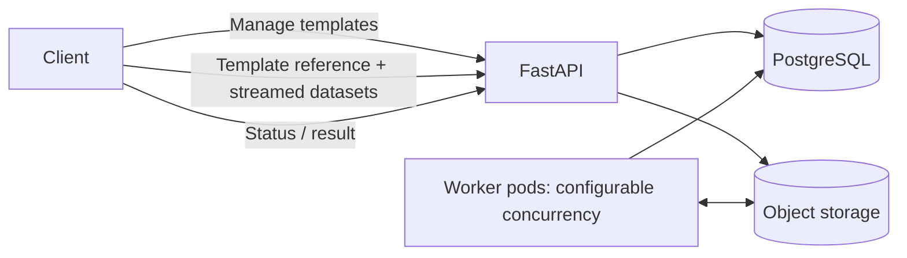

# CardReport Server design

Status: reviewed implementation proposal; Claude initial and focused reviews complete.
Date: 2026-11-06. Owner: Oleg Orlov.
Scope: a separate project alongside CardReport, not a library refactor.

## 1. Purpose and boundaries

Offer an internal HTTP service for reusable templates and asynchronous report
creation. Several applications can use the same engine without installing Python,
Chromium or fonts. Separate deployments scale API traffic and rendering work.

User decisions:

- Template management is independent of generation and data submission.
- Metadata belongs in a database; worker pods are replaceable/stateless.
- Clients stream named datasets with the generation request.
- FastAPI exposes OpenAPI and Swagger UI.
- No built-in authentication; deployment is inside a trusted internal network.
- Worker concurrency is configurable, not fixed at one report per pod.
- Keep the initial implementation small; review this design with Claude first.

First version: template CRUD without destructive version deletion, asynchronous
PDF/static HTML generation, status/download, bounded uploads, worker recovery,
retention and basic observability. PostgreSQL plus S3-compatible storage are the
only required stateful dependencies. No separate queue broker initially.

Not included: report editor, SQL execution, source connectors, scheduling, email,
webhooks, tenant isolation, arbitrary Python/HTML/CSS, plugins, resumable uploads,
inline templates on generation, synchronous waiting, or a standalone SDK.
CSV multipart upload is deferred; clients can use CardReport's existing CSV
adapter to produce the same named-dataset envelope. This does not remove CSV
support from the library. Both Chromium and the library's experimental SVG/WeasyPrint
renderer are included in the worker image and selected per job.

## 2. Relationship to CardReport

The service owns transport, persistence, lifecycle and operations. CardReport
owns template/data formats, validation, binding, layout and rendering. Never copy
its schemas or add a second interpretation of dataset cell types.

Inspected library baseline: 0.8.1, source commit
`e5a5ae3a5b5bb9b1f012ed39b3230c8f02d00d14` (documentation after the release).
Public pipeline: ReportTemplate.from_json/from_yaml -> datasets_from_json/from_yaml
-> template.bind(datasets) -> report.to_pdf/to_html. No fork/private APIs required.

Important existing limits: templates are bounded to 1 MiB, data JSON to 16 MiB;
default DataLimits include 2,000 rows, 100 columns, 32 datasets and 100,000 cells.
Library limits may only be reduced. Streaming HTTP does not remove these limits:
decoding, immutable datasets, charts and page layout still materialize bounded
input. This service is not a streaming renderer for arbitrary-size databases.

Use a tested exact CardReport dependency in the deployable image/uv lock. Record
the service version, CardReport version and image build identifier on jobs.
A pinned template is not a promise of byte-identical PDF output across engine,
font or browser upgrades. Revalidate templates on load; never rewrite stored versions.
For an engine/format-affecting upgrade in v1, pause admission and template mutations, drain accepted jobs,
upgrade API and workers together, run stored-template compatibility checks/startup
smokes, then resume. Do not mix unverified engine versions during a rolling update.
On incompatibility keep admission paused. Roll back only to an image verified
against the actual DB revision; otherwise use a forward fix or a separately approved
offline restoration plan. See the implementation plan's rollback rule. No
zero-downtime promise.
Ordinary replica scaling uses the same immutable image.

## 3. Deployment shape



One repository and initially one container image with two entry points: api and
worker. Two Deployments, independent replica counts, no persistent pod volumes.
Temporary files are allowed; durable ownership and input/result data live outside
the pod. Worker execution in v1 requires a container runtime; native API debugging
is supported, native worker hard-stop semantics are not. Use Compose locally.
Use a dedicated, unshared temporary root and remove service-owned leftovers at worker startup,
including after a container restart with a surviving emptyDir. Keep per-container
PID namespaces; do not enable shareProcessNamespace. A worker supervisor claims only as many jobs as it has available slots.
The supervisor downloads input and the pinned template into a private per-attempt
temporary directory; a fresh child reads them, decodes/binds/renders and writes an
output file. The supervisor uploads output and makes the fenced DB commit. Children
receive an allowlisted environment without DB/S3 credentials and no live DB clients.
Bound temporary storage by concurrent uploads/slots, input and result limits.
CardReport creates its own PDF subprocess/browser descendants; see section 8 for
whole-container termination as the hard cleanup fallback. Do not use a persistent
ProcessPoolExecutor/multiprocessing pool for independently killable report attempts.

Planned modules: api, templates, jobs, worker, storage, settings and db/migrations.
Use ordinary functions and small typed records; no generic workflow/plugin layer.

## 4. Template management API

All resource routes use `/v1`. Health/docs/metrics routes are unversioned.
Template IDs are caller-chosen bounded slugs; revisions are server-assigned positive
integers. IDs match `[a-z0-9][a-z0-9_-]{0,63}`. Upload body is the existing CardReport template envelope, JSON or YAML.

| Method and path | Behavior |
| --- | --- |
| POST /v1/templates/{template_id}/versions | Create template if absent, append an immutable version; 201 |
| GET /v1/templates | Cursor-paginated metadata; optional archived filter |
| GET /v1/templates/{template_id} | Metadata, active/archived state, latest version |
| GET /v1/templates/{template_id}/versions | Cursor-paginated version metadata |
| GET /v1/templates/{template_id}/versions/{version} | Canonical template JSON and version metadata |
| PATCH /v1/templates/{template_id} | Set archived true/false; no layout mutation |

Validate using the public template loader before insertion. Store its canonical
JSON, digest and validation library version, not executable code. Original YAML
styling/comments are not retained. Atomic allocation under a template-row lock and
unique (template_id, version) constraint handles concurrent writers. Creating an
existing template never replaces it. Appending to an archived template returns 409.
Version numbers are never reused; modifying layout means creating a new version.
No hard-delete endpoint in v1. Archiving blocks all future submissions, including
explicit version references. Already admitted uploads/jobs continue. Any admitted
caller can change latest by appending a version; production callers should pin a
version. Only application/json and application/yaml are accepted, with an optional
UTF-8 charset; there are no YAML media-type aliases in v1.

## 5. Generation API and data contract

| Method and path | Behavior |
| --- | --- |
| POST /v1/reports?template_id=...&template_version=...&output=pdf | Stream data, persist input/job, return 202 + Location |
| GET /v1/reports/{report_id} | State, selected version, timestamps, attempt count, error, expiry |
| GET /v1/reports/{report_id}/content | Stream completed PDF/HTML as an attachment |

`template_id` is required. `template_version` is optional: resolve latest at
admission, before consuming the upload, then retain that immutable version.
`output` is pdf (default) or html. `renderer` is chromium (default) or weasyprint,
persisted per job and retained across retries. Both support PDF and HTML; WeasyPrint
supports dashboard only and reports unsupported features without fallback. PDF is
the authoritative checked output. Chromium HTML does not perform browser geometry
checks at export; WeasyPrint HTML is measured but may differ in another browser.
Every worker checks both engines at startup. There is no runtime layout,
language or arbitrary renderer-class override: presentation belongs to the template;
dynamic titles/text can be supplied through declared datasets. No general parameter
or expression language is added. Execution limits come from server configuration.

Request Content-Type: application/json or application/yaml (UTF-8). Body is exactly
`cardreport.data/1`, not an array per dataset and not a new server-specific envelope:

```json
{
  "format": "cardreport.data/1",
  "datasets": {
    "summary": {
      "columns": ["total"],
      "rows": [{"total": 34}]
    }
  }
}
```

Clients choose JSON/YAML independently of the registered template's input format.
Tagged decimals, dates and datetimes retain the library's existing semantics.

Return 202 only when the complete input object exists and the queued job transaction
has committed. Response contains id, state=queued, template_id, resolved
template_version, output, renderer and relative status/content URLs. 202 means durable
acceptance, not successful data validation, binding or rendering.

Metadata is checked before upload. Syntax, dataset types/cardinality and binding
are checked inside the worker so request handling does not parse the whole body.
Invalid data becomes a failed job with a structured error, never a successful empty
report. Template registration errors are synchronous 422 responses.

Admission errors: 404 unknown template/version; 409 archived; 413 size limit;
415 unsupported content type/encoding; 422 invalid query/metadata; 429 configured
admission capacity exceeded with Retry-After; 503 unavailable DB/storage.
Unsuccessful upload creates no runnable job. A 404 report is unknown, 409 content
is not ready/failed, and 410 content has expired. Failures use a stable error object.

Swagger must describe the existing data shape and both media types despite the
streaming Request implementation: derive/embed the packaged CardReport schema in
OpenAPI rather than maintaining a second schema. Use OpenAPI 3.1; namespace the
library's root/$defs under components/schemas, rewrite local $refs accordingly and
remove resource $id values from the embedded copy. Assert every generated reference
resolves and validate example bodies against the original packaged schema. Attach
requestBody metadata explicitly for the raw Request route; it documents but does
not execute runtime validation, which remains in CardReport. Swagger sends a normal bounded
body; automated clients may send chunks. Client documentation must demonstrate
iterating a file rather than loading it into one bytes object.

No submission deduplication in v1: if a 202 response is lost, a client retry can
create another report. Do not auto-retry POST in the example client. Document this
explicitly; an Idempotency-Key protocol is a later extension if required.

## 6. Streaming and admission

Use Starlette Request.stream(), not request.json()/body() or a Pydantic model for
the dataset body. Iterate with backpressure into a private temporary file, counting
bytes and hashing incrementally; reject over-limit input even without Content-Length.
Then upload that bounded file with a single S3 PutObject, create the job and return
202. This deliberate spool avoids implementing a custom S3 multipart state machine
for the library's small input cap. It costs one extra local disk pass.

The cap is at most the library's 16 MiB encoded-input budget, configurable downward;
template input has the 1 MiB cap. Reject a declared Content-Length above the cap
before reading, and still count actual bytes. Pass raw bytes and the same reduced
DataLimits to datasets_from_json/from_yaml and bind. Reject compressed request bodies in v1 so wire
bytes cannot bypass limits. Bound concurrent uploads, total upload duration and
idle read time; enforce temporary-disk limits. Do not hold a DB transaction or
connection during network upload. Offload synchronous file/SDK work from the event
loop using bounded threads. Configure the ingress to avoid whole-request buffering;
verify chunked transfer through the actual proxy, not only the ASGI test client.

Admission capacity is explicit: a per-API-pod upload semaphore returns 429 when
full. An indexed DB count of queued/running jobs is a soft global backlog threshold;
return 429 above it, accepting small bounded concurrent overshoot rather than a
serialized global counter. Recheck before job insertion if the upload was long;
rejection leaves an orphan for cleanup. Unavailable dependencies return 503, not 429.

Store under a unique server-generated input key. Never use caller paths/filenames.
If storage succeeds but DB insertion fails, the object is an orphan and becomes
eligible for delayed cleanup. If the client disconnects before complete intake,
abort and remove this request's temporary file. After the object/job commit, losing
the response must not cancel the durable job. An archive operation after admission
does not invalidate that in-flight submission. Existing versions cannot disappear.

No claim of end-to-end constant memory: the API avoids whole-body memory buffering;
workers still pay decoding/model/Plotly/browser memory costs. Error and output size
limits matter as much as request bytes.

## 7. Database and job lifecycle

Minimal tables:

- templates: id, archived, created_at, latest_version.
- template_versions: template_id/version, canonical JSON, digest, validated_with,
  created_at; immutable and referenced by jobs.
- reports: UUID, template FK/version, state, input key/type/size/hash, output kind, selected renderer,
  result key/size/hash, attempt number/token, lease_until, next_attempt_at,
  created/started/finished times, retention timestamps, structured error,
  actual service/library/image versions.

State transitions:

```text
queued -> running -> succeeded -> expired
                  -> failed    -> expired
                  -> queued    (bounded infrastructure retry)
queued            -> failed    (maximum queue age)
```

Use a short PostgreSQL transaction with SELECT ... FOR UPDATE SKIP LOCKED to claim
eligible jobs and atomically assign a fresh attempt token, attempt number and lease.
Commit before work starts. No database lock/transaction spans a render.
Use DB time for leases and deadlines. An independent supervisor heartbeats while
child processes are busy; a worker with exhausted slots stops claiming. Claim FIFO
by created_at/id among jobs whose next_attempt_at has passed. Add a partial index
on (next_attempt_at, created_at, id) WHERE state='queued'. Poll at a configurable
interval with jitter and immediately when a slot frees. Batch heartbeat updates
per tick. Maximum queue age always counts from original created_at, not requeue.

Every heartbeat and completion/retry update is conditional on report id, state,
attempt token and an unexpired lease. Expired leases cannot be revived. On lost
ownership, terminate that attempt's child process tree; do not publish its result.
A reaper uses locked transactions to reclaim expired attempts and enforce max
attempts. Multiple reapers must be safe. This is at-least-once execution: two
attempts may briefly run, but only the current owner can commit a terminal result.

Write outputs under unique report/attempt object keys, then conditionally commit
the DB pointer. A stale attempt must never overwrite or delete a winning result.
A crash between object upload and DB commit leaves a collectible orphan. Download
only the DB-committed object; never discover the latest object by listing a prefix.

Retry only infrastructure failures (e.g. transient storage/network failure or lost
worker), with bounded backoff. Data/template/binding/layout/unsupported-feature
errors are terminal. Render timeout is terminal by default; repeatedly retrying a
resource-exhausting report is not a recovery strategy. A lost worker/OOM can retry
within the attempt cap, then fails with a stable code rather than looping forever.

| Failure | Job / worker action |
| --- | --- |
| DataError, TemplateError, BindingError, ValidationError | Terminal validation failure with safe locations |
| LayoutOverflowError, UnsupportedFeatureError | Terminal; no silent layout fallback |
| RenderTimeoutError, other RenderError | Terminal render failure by default |
| Transient storage/DB/network error, lost worker | Bounded infrastructure retry |
| DependencyError | Stop claims and fail worker startup/readiness; recover current owned attempt through infrastructure policy |

Use exception types/location fields, not parsing exception text. An unexpected
exception is a terminal internal error with a correlation id, not a leaked traceback.
A DependencyError after startup also disables further claims; do not fail a queue
of jobs against a broken renderer image.

Structured errors include code, stage, safe message, retryable and optional known
component/dataset/row/field locations. Do not return traceback, payload cells,
credentials or storage internals. Chart-label exceptions can contain report values:
map them to safe public messages instead of exposing arbitrary exception strings.

## 8. Concurrency, shutdown and Kubernetes scaling

WORKER_CONCURRENCY controls the number of simultaneous report attempts per pod.
It is independent from pod replica count. Initial example configuration: 2 slots,
explicit CPU/memory/ephemeral-storage requests and limits; this is a provisional
starting point, not a measured recommendation or throughput promise.

Keep children bounded; no unbounded background tasks or process pool submission
queue. Start each attempt child in its own session, with a termination handler that
unwinds its render call so the library's finally cleanup can run. Give to_pdf a
remaining deadline minus cleanup margin; its timeout should precede the supervisor
backstop. Before calling to_pdf, treat nonpositive remaining time as timeout and
cap the renderer timeout at the library maximum of 300 seconds. Do not turn an
expired execution budget into an input ValidationError. Do not assume killing the attempt process group kills Chromium: the
library starts its own PDF worker with start_new_session=True (pdf.py).

On lost lease/deadline request graceful child termination. If it cannot finish and
clean up within a short bounded grace, recycle the entire worker container; the
runtime must terminate all descendant processes. Hard-fallback exit is non-zero;
a completed graceful SIGTERM drain exits zero. Use an init process as PID 1.
Stop claims first; let unfinished leases expire after container termination. This
avoids a custom process tracker and detached-orphan guessing in v1. Test the hard
fallback against actual Chromium descendants. One hard-stop attempt can interrupt
other slots, whose jobs are recoverable by the same bounded lease policy.

Stop claiming on SIGTERM, continue heartbeats while draining active attempts within
a grace period, then use the same container-termination fallback. Do not mark an
unfinished report successful during shutdown.

A pod/container OOM may interrupt every slot; precise kill behavior depends on the
cluster/runtime. Count each claimed job's attempt independently; do not guess which
report caused the OOM. Budget memory from measured concurrent peaks plus supervisor
and SDK overhead; a memory-heavy job can disrupt neighbours until the attempt cap.
No per-slot memory isolation is promised. Do not change oom_score_adj in v1.

HPA can initially scale worker Deployments using CPU with Metrics Server and CPU
requests configured. Minimum one worker replica. Queue depth/oldest age are exported
and preferred for later workload-aware scaling, but require an adapter/scaler;
Prometheus metrics alone do not configure HPA. No KEDA/Prometheus Adapter dependency
in v1 and no scale-to-zero promise. API scales separately. Tune concurrency and
resource settings with real PDF/HTML workloads before selecting production targets.

Suggested starting limits for tests/configuration: 120-second total upload deadline,
30-second idle upload timeout, 60-second lease with 15-second renewal, 120-second
whole attempt deadline, 3 attempts, 1-hour maximum queue age. Validate relationships
at startup and align pod termination grace with draining. These are tunable defaults,
not library limits; the renderer receives the remaining bounded render timeout.

## 9. Storage lifecycle and internal access

Keep data and generated files private to the service's bucket prefix. Serve downloads
through the API using bounded streaming and Content-Disposition: attachment;
HTML is downloaded rather than served as an application on the API origin. Send
X-Content-Type-Options: nosniff. Initial output cap is 32 MiB (PDF and HTML), tunable
independently from the input cap; reject oversized outputs before upload. This
bounds storage/transfer, not peak renderer memory, because library methods return
materialized bytes/text.
Use single PutObject for the bounded output as well as input; no custom multipart
upload state machine. Avoid presigned URLs in v1. No arbitrary object URL or external resource fetching.

After a terminal result, input is no longer needed for internal retries; retain it
for a short configured grace (initially 1 hour). Results remain downloadable for
24 hours after success; metadata/errors for 7 days after termination.
The expired state means artifacts are unavailable: succeeded becomes expired when
its output TTL elapses; failed becomes expired when its input grace ends. Retain
terminal outcome/error and finished_at separately so expiry does not erase history;
purge metadata only after its retention deadline and confirmed object cleanup. Durations are
operator settings and are recorded per job. No report replay endpoint in v1.

A periodic worker maintenance loop handles leases and cleanup in bounded batches;
no dedicated scheduler service. Cleanup expires content visibility before deleting
its object, retries failed deletes, and only removes unreferenced objects after a
grace greater than the maximum upload/attempt duration. A bounded periodic prefix
scan finds unreferenced objects, including failed-attempt outputs, and checks them
against DB references; object listing is only for garbage collection, never for
choosing a report result. Repeat sweeps so delayed storage writes are collectible. Final commits enforce those
deadlines to prevent orphan cleanup racing a late upload/completion. Protect active
jobs and their inputs. Bucket lifecycle rules must not expire objects still owned
by active jobs. Keep storage operations bounded; the service does not initiate multipart uploads.
For downloads, reject expired content before headers, enforce a bounded download
duration and delay physical deletion beyond that duration after logical expiry.
A mid-stream failure aborts the connection; it cannot change the HTTP status.
Retention never deletes registered template versions in v1. Metadata deletion must
not lose the last pointer to an object awaiting deletion.

No users/roles/tokens/tenants. Every permitted caller can manage templates and read
report IDs it knows. UUIDs are identifiers, not access control. Use a ClusterIP or
private ingress with operator-managed network policy; no public ingress by default.
Disable cross-origin API access by default. Bound uploads, queue admission, result
size and execution even for trusted clients. The renderer process has no need for
network egress; do not let submitted data select URLs or execute code.

## 10. Technology and documentation plan

Python 3.12+, uv, FastAPI/Uvicorn/Pydantic for HTTP/settings, psycopg 3 and its pool
for explicit PostgreSQL operations, boto3 for S3, and cardreport[pdf,weasyprint] for rendering.
Use one standard SQL migration mechanism selected during the persistence slice;
do not invent a general ORM/repository abstraction. Add runtime dependencies only
when implemented and lock the deployment environment. Chromium, fonts and WeasyPrint native libraries are installed at image build time.
Bundle Swagger UI assets with the image so /docs works without CDN access.

README remains the user entry. As implementation lands, add user quickstart with
separate template registration and file-streaming submission, API reference,
configuration/retention guide, internal Kubernetes deployment guide and diagnostic
examples. OpenAPI is generated from implemented routes; do not commit a second
hand-maintained endpoint schema. Include one real CardReport reference report
and one long-table flow report, using public/synthetic fixtures only.

## 11. Implementation slices and acceptance

The [implementation plan](implementation-plan.md) expands this sequence and starts
local dependencies/container foundations early. Compose is the daily environment;
kind is a later Kubernetes acceptance lane. Neither stack exists in the scaffold yet.

The implementation plan's S1–S6 order and exit criteria are authoritative for
execution. In particular, the first working worker includes minimal lease recovery,
stale-owner fencing and a real hard-stop test; these cannot be postponed until the
later recovery/retention expansion. Avoid maintaining a second stage checklist here.

Each slice gets tests and documentation before the next dependent slice. Use real
PostgreSQL for claim/race tests and a tested S3-compatible endpoint for object
semantics; mocks cannot establish those properties. Confirm actual output page count,
text preservation and complete table rows. Exercise a worker replacement and prove
only one result pointer wins. Check OpenAPI example/schema agreement with CardReport.

Expose /health/live (process), /health/ready (required dependencies), /metrics and
/docs. Workers run a renderer startup smoke before claims and stop claims while required
dependencies are unavailable. Expose supervisor progress for liveness and startup
checks; no worker Service routing depends on readiness. Full occupancy is not a
liveness failure. Probe failure alone does not stop queue claims: worker logic does. Metrics include queued
jobs, oldest waiting age, active slots, upload/render duration, retries and failures.
Never label metrics with report id, dataset contents or template text.

## 12. Sources and review

Implementation constraints were checked against the current library checkout and
its [template guide](https://github.com/arch7tect/cardreport/blob/e5a5ae3a5b5bb9b1f012ed39b3230c8f02d00d14/docs/user/templates.md)
and [dataset guide](https://github.com/arch7tect/cardreport/blob/e5a5ae3a5b5bb9b1f012ed39b3230c8f02d00d14/docs/user/datasets.md).
Platform references:

- [Starlette request streaming](https://starlette.dev/requests/).
- [PostgreSQL row locks and SKIP LOCKED](https://www.postgresql.org/docs/current/sql-select.html).
- [Kubernetes HPA metrics and prerequisites](https://kubernetes.io/docs/concepts/workloads/autoscaling/horizontal-pod-autoscale/).
- [S3 multipart lifecycle](https://docs.aws.amazon.com/AmazonS3/latest/userguide/mpuoverview.html).

These support implementation choices, not a claim that this service is implemented,
benchmarked or production-ready. [Review record](reviews/2026-11-06-design.md).
