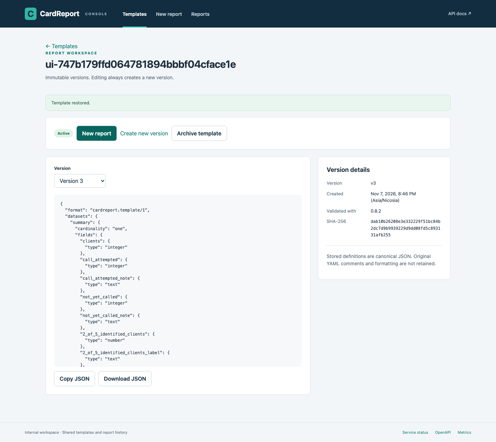
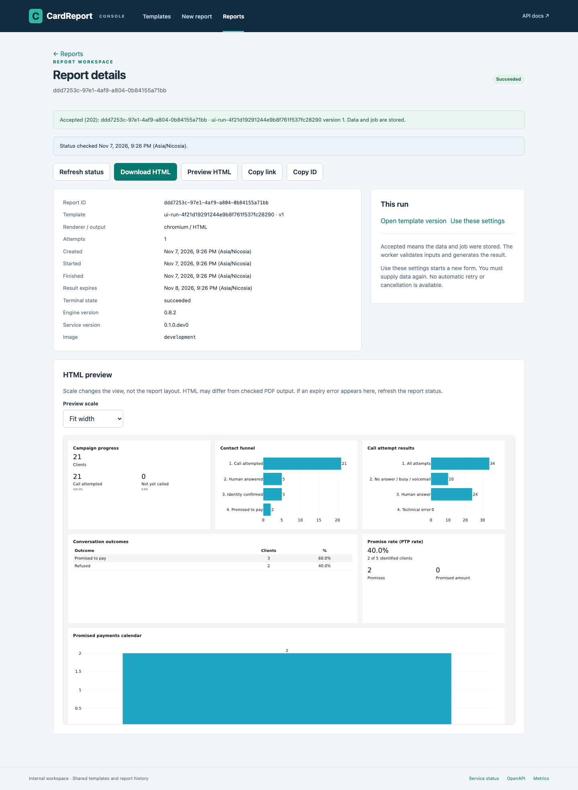

# Web console

[README](../../README.md) · [HTTP API](api.md)

Open `/ui/` on the API address: `http://127.0.0.1:18000/ui/` with Compose,
or `http://127.0.0.1:8000/ui/` for a native API. The console is served by the same
image/package, without Node, a frontend server or internet assets. Swagger remains
at `/docs`. JavaScript must be enabled. All internal callers share this workspace;
there is no per-user access control or private report history.

## Templates

Browse active/archived templates, open metadata and choose an immutable version.
**Search templates** matches any part of the ID or the latest version's report title,
without case sensitivity. The latest title appears below the ID; old version titles
are not searched. Apply with **Search**, Enter or by leaving the search field.

**Previous / Next** show up to 50 templates per page while preserving the search
and Active / Archived / All filter. Search/filter changes and **Refresh** start at
the first matching page. **Clear filters** clears the search and restores Active.
A failed page request preserves the current rows for retry. There is no total page
count; this is a live list, not a snapshot. Filters and page history reset when you
leave or reload the view. **Load more versions** still expands the version selector
on a template detail page.

Create a template by importing
JSON/YAML or pasting source and choosing its format. Save validates the source and
creates a version; an error retains the editor contents. The safe API error may
include a template path, not the full library traceback.

Create new version starts from the selected canonical JSON. Existing versions are
never overwritten. YAML comments/style are not stored. Copy/download exports that
canonical JSON. Another caller may save first, so the resulting version is the one
returned by the server, not necessarily the selected number plus one.

Archive blocks new versions and reports, while retaining existing definitions and
already accepted jobs. Restore enables new work. Concurrent changes are resolved
by the server. Unsaved source stays only in page memory; navigation warns before
discarding it. A reload or closed tab does not provide durable draft storage.

The template detail's **Report retention** sets the lifetime for future runs, starting
at completion. Enter the number of **days**; fractions are allowed
(for example, `0.5` days is 12 hours) and rounded to the nearest second.
Leave empty to inherit the server default. Effective retention and
report details use readable days/hours/minutes/seconds. Saving an unchanged value
preserves its exact whole-second duration, including short values set through the API.
This setting applies to originals, normalized data and output, creates no new template version, and does not change existing runs. Save
explicitly; navigation warns about unsaved edits. Report details show the captured
duration and input expiry. Templates themselves do not expire.

Service status checks API liveness and database/storage readiness on demand. It
does not assert worker health. OpenAPI, Swagger and raw metrics have direct links.

## Generate a report

Choose **New report**, select an active template and a version. Use Load more for
additional templates/versions. An explicit version is selected by default; Latest
at submission lets the server resolve the latest version before reading data.
A New report action on a template detail pins the viewed version.

Choose Chromium or WeasyPrint and PDF or HTML. WeasyPrint supports dashboard
layouts; use Chromium for flow and table pagination. **Add files** accepts JSON,
YAML and CSV in any combination. Each selection adds to the visible list; cancelling
the file chooser keeps earlier selections. Use **×** beside a file to remove it
before submission. Removing the last file leaves an empty list; Generate asks for
at least one file. Switching to **Paste text** keeps the file list until you leave
the form, and submits only the pasted bundle. No original file is changed.

JSON/YAML files are `cardreport.data/1` bundles with their own dataset names. CSV
filenames name datasets (`summary.csv` → `summary`), with column types from the
pinned template. Names must be unique across every file. Files go directly to the
server without browser parsing. Paste mode lets you explicitly select JSON/YAML.

Expand **CSV options** to set encoding (default `utf-8`), a one-character delimiter
(default comma; enter `\t` for a tab), or exact null tokens, one per line. **Treat empty cells as null**
adds the empty token explicitly. Without that option, empty text stays empty and
empty numeric cells fail validation. Use `utf-8-sig` for UTF-8 CSV with a BOM.
Options apply to every CSV file in the submission; bundles retain their
own JSON/YAML types. The full multipart body, including boundaries and options,
must fit the configured input cap. File-size prechecks cannot include all transport
overhead; the server remains authoritative.
The console checks library hard caps; configured server limits can be lower.

Generate submits once and opens the accepted job. A 202 response means that data
and job metadata were stored, not that parsing or rendering succeeded. The worker
performs those checks. If acceptance is uncertain after a lost response, check
Reports before deliberately resubmitting: the original job may already exist.
The same rule applies to saving a new template version. No mutation is retried
automatically; disabled buttons prevent accidental duplicate clicks while sending.
A closed or navigated-away page does not cancel server work.

## History, status and results

Reports lists retained jobs from every caller, with template ID, state and creation
time filters. **Created from** includes the chosen time; **Created before** excludes
it. Either can be left empty. Times use the browser's displayed timezone and are
sent to the API with an explicit UTC offset. For all of November 9, choose November
9 at 00:00 through November 10 at 00:00. Nonexistent local times during a daylight
saving transition are rejected; for a repeated hour, browser conversion chooses
the earlier occurrence. The API accepts explicit offsets when that distinction matters.

Each page contains at most 50 reports. **Previous / Next** replace the current page
and preserve all filters. Changing a filter, **Clear filters**, or **Refresh** starts
at the newest matching page. A failed page request keeps the current page, so it can
be retried without skipping rows. There is no total page count. Filters and cursor
history remain in this view only; reloading or leaving it starts a fresh search.
The list is a live view, so concurrent commits/state changes and
retention are not a frozen snapshot. Expired rows retain the former terminal state,
including failed jobs. Once metadata retention ends, a report is no longer listed.

Open a row to see its bookmarkable UUID, pinned template, attempts, timestamps,
renderer/output, safe error and actual versions. Only the visible, nonterminal
detail is polled. Polling pauses in hidden tabs and stops on navigation or terminal
state; temporary read errors back off and mark the displayed status stale. Refresh
status is always available. Health/readiness and report success are separate checks.

**Show input files** lists exact original uploads, their sizes, SHA-256 hashes,
parse results and supplied datasets. It works for pending and failed reports too.
Download one original file or **Download investigation ZIP** for the originals,
pinned template and diagnostics. **Download original request** also works when
multipart is damaged and cannot be split into files. Unknown parsing status means
no completed diagnostics were saved, not that parsing succeeded. Hide/reopen the
panel to refresh it after a running job finishes. Downloads expire with the run's
retention; old jobs keep their earlier expiry schedules.

**Show data** opens the immutable datasets saved with this successful report.
Select a dataset to see columns and up to 100 rows, then use Previous/Next rows.
The viewer preserves exact numeric values and escapes text; null appears as `∅`.
**Download data JSON** returns the whole typed bundle for reuse. **Hide data**
closes the table. A temporary page error offers **Retry rows**; if the dataset
list itself fails to load, hide and reopen data. Neither changing a template nor expiring the original upload
changes these saved data. Data expires together with the result. Older reports
show an unavailable explanation; failed reports do not save snapshots.

Download retrieves the original committed bytes. **Open PDF** opens the same result
in a new tab using the browser’s native PDF viewer; Download remains a separate
action. Browser preferences or a missing PDF viewer may cause a download instead.
**Open HTML** opens the report in a separate tab at its original size, without
opening the embedded preview. It retains the server’s isolated HTML policy.
**Preview HTML** opens an isolated frame in the console; **Hide preview** closes
it and releases its resources. You can reopen it while the result is available.
If a result expires before Open HTML or Open PDF loads, the new tab displays
the API error.

Chromium and WeasyPrint HTML both work, but only PDF performs the authoritative
layout/export checks. **Fit width** scales the complete report to the available
width without rearranging its charts or tables; **100%** uses the original scale
with scrolling. The fit follows window resizing. If template dimensions cannot be
loaded, the preview remains available at its original scale. If retention expires after the status check, the frame may show
a safe JSON error; use Refresh status. The endpoint remains the final authority
on whether a result is downloadable. Failed/pending results have no partial output.

Use these settings prefills a new submission form; you must select or paste data
again. Original inputs can be downloaded from report details. There is no cancellation or
server-side rerun action. Drafts/data are never stored in browser localStorage or
sessionStorage, and the console does not add authentication or per-user visibility.

## API coverage

| API capability | Console location |
| --- | --- |
| List/filter templates and list versions | Templates, version selector, Load more |
| Get template/version definition | Template detail; canonical JSON copy/download |
| Create immutable version | Create template / Create new version |
| Archive, restore and retention | Template detail |
| Submit report with data/renderer/output/version | New report |
| List retained jobs and filter | Reports |
| Get status/attempts/error/versions | Report detail |
| Original files, parsing diagnostics and investigation ZIP | Report detail, Show input files |
| Normalized datasets and JSON download | Report detail, Show data |
| Get result content | Download; collapsible HTML preview with scaling; Open HTML/PDF in a new tab |
| Liveness and readiness | Service status |
| Swagger, OpenAPI, raw metrics | Navigation/footer links |

## Screenshots and tested scope

The screenshots use the bundled synthetic reference example.

Browser acceptance uses Playwright Chromium. Desktop and narrow layouts are
checked; other browser engines are not yet verified. Deploy the console at the
root-hosted `/ui/` path alongside `/v1`, `/docs` and `/static`. Reverse-proxy
subpath rewriting is not supported. The UI and Swagger require no external assets.

## Understanding layout failures

Failed layout jobs show a **Layout diagnostics** section when the renderer supplied
a diagnostic: component path, PDF page, available width/height and the sides where
content exceeds its area. Values are displayed in millimetres. A reason-specific
hint suggests changing block space, moving content or adjusting chart labels.

The numbers describe current layout; they do not prescribe a guaranteed resize.
Changing width can rewrap text and changing height can move another block off the
page. Chart-label collisions may have no dimensions. Unmeasured sides are not zero.
Old jobs remain readable with their original generic error; refreshing does not
retroactively measure them. Submit a new report with the upgraded worker to obtain
new diagnostics. The input files remain downloadable until their retention expires.

## Daily report text

Import [daily_template.yaml](../../examples/daily_template.yaml) on **Create template**
and save it. Its title uses `{{ datasets.summary.report_date }}`; dates and numbers
inherit the report formatting. From that template, create a report and add
[summary.csv](../../examples/daily_csv/summary.csv) in **Data files** (or use the
[JSON](../../examples/daily_data.json) or [YAML](../../examples/daily_data.yaml) dataset).
Choose HTML for an embedded preview, or PDF with either renderer. The result shows
`Daily report for 14.11.2026`, `Month: November 2026` and `Automation: 97.6%`.

For the next day, change the input date and submit another report using the same
template version. Template editing/history shows the source expressions; preview
and downloaded output show substituted values. The existing input-file download
and normalized data view remain available for investigation. See the
[API recipe](api.md#daily-report-text) for automated submissions.
